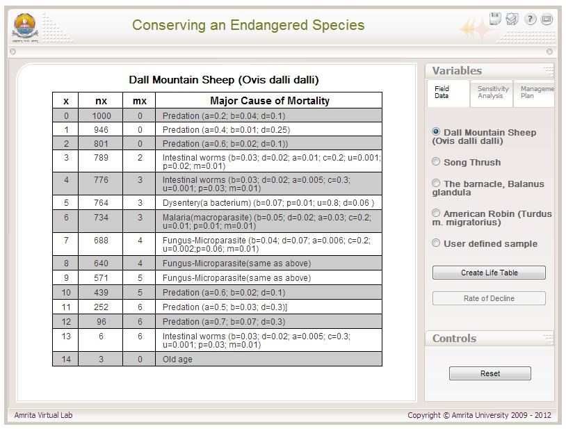

### Procedure

1.	User can open the simulator window. The simulator window provides a panel including a list of predefined species along with an option to create a custom life table. Users can select a species, perform the demographic analysis using the Compute button. The interface also includes controls button to reset the simulation and options to download the results in PNG or CSV format. Upon computation, the simulator displays the survivorship curve, population metrics, life table, and Leslie matrix, enabling the user to analyse the population dynamics of the selected species.

&nbsp;

2. Select one species by clicking the corresponding radio button. The available options include Dall Mountain sheep, Song thrush, Barnacle (Balanus glandula), American robin, Build your own table. Verify that the desired species is highlighted, indicating that it has been selected. 

&nbsp;

3. For example, if user choose Dall Mountain sheep and click on the compute button to generate the demographic analysis for the species. 

&nbsp;

4. The simulator computes and displays the survivorship curve together with key population metrics that describe the growth characteristics and conservation status of the selected species. These outputs provide the basis for interpreting population dynamics and identifying critical life stages for conservation management. The survivorship curve illustrates age-specific survival within a population and provides insight into mortality patterns. Demographic parameters such as R₀, generation time (T), intrinsic rate of increase (r), and finite rate of increase (λ) quantify population growth potential. These metrics, together with ecological interpretation, helps to identify vulnerable life stages and guide effective conservation strategies for endangered species.

&nbsp;

5. After the demographic analysis is completed, the Life Table displays age-specific survival and reproductive information for the selected species. Users can examine demographic parameters across different age classes and identify the factors contributing to mortality. The life table provides the fundamental data required to understand population dynamics and construct population projection models. The highlighted age class assists in identifying priority stages for conservation intervention.    

A life table is a fundamental demographic tool used to summarize survival and reproductive characteristics across different age classes within a population. Parameters such as survivorship (lₓ), survival probability (Pₓ), and fecundity (mₓ) are used to estimate population growth rates, calculate generation time, and construct Leslie population projection matrices. These analyses support ecological research and conservation decision-making.

&nbsp;

6. After the demographic analysis is completed, the Leslie Matrix is generated to represent the age-structured population model for the selected species. The matrix summarizes the age-specific fertility and survival parameters derived from the life table and provides the basis for projecting future population dynamics. The Leslie matrix is a discrete, age-structured population projection model widely used in population ecology. It incorporates age-specific fertility (Fₓ) in the first row and survival probabilities (Pₓ) in the sub-diagonal. By multiplying the Leslie matrix with a population vector, the population size and age structure can be projected across successive generations. This approach is widely applied in wildlife management, conservation biology, and population viability analysis.

&nbsp;

7. Observe the sub-diagonal entries which contain the survival probabilities (Pₓ) representing the transition of individuals from one age class to the next. Note that all remaining matrix elements are zero, indicating that only fertility and age-to-age survival transitions are incorporated in the model.  Compare the fertility and survival values in the Leslie matrix with the corresponding values presented in the Life Table.  Use the Leslie matrix together with the survivorship curve and population metrics to understand the age-structured dynamics of the selected population.

&nbsp;

8. Simulator allows the user to choose any of the available species from the Choose a species panel to perform demographic analysis. After selecting a species, click the Compute button to generate the corresponding survivorship curve, population metrics, life table, and Leslie matrix. The results can be compared across different species to understand variations in age-specific survival, reproductive patterns, and population growth characteristics. Also, user can select the Build your own table option to perform demographic analysis using user-defined life-table data. If required, click Reset to clear the current analysis before selecting another species.
